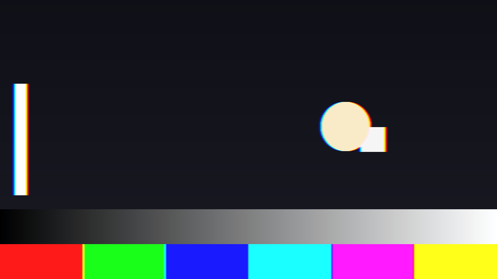
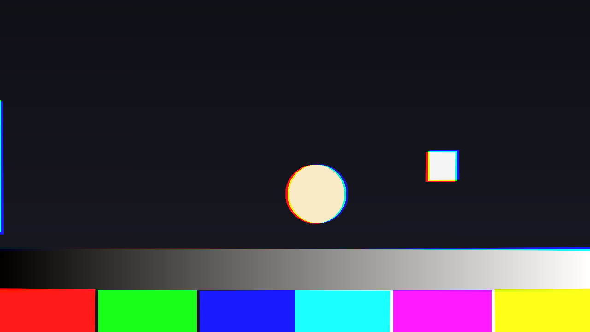
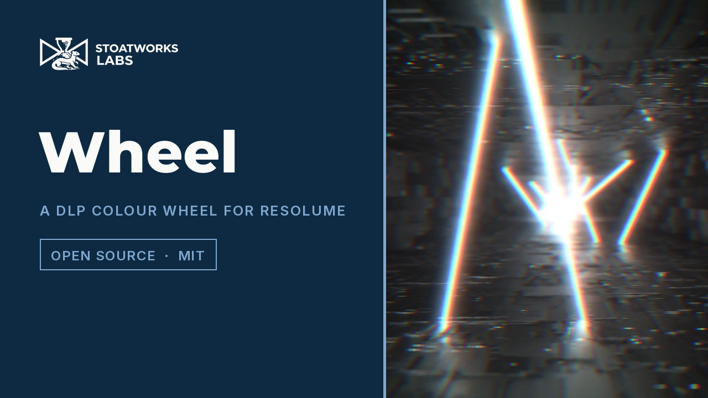

# Wheel

> **AI-assisted project.** This codebase was created with [Claude](https://claude.com/claude-code)
> (Anthropic), directed and reviewed by a human author. The model is checked numerically by an
> offline harness that drives the real plugin code without a host: a still eye gets the input
> back bit for bit, a pursuit lands the red and green fields `v(t_G − t_R)` apart, and every one
> of those checks is shown to fail when the model is nudged wrong. It's **never been loaded
> into Resolume on macOS**. On Windows, a build of v0.1.0 loads, registers and renders in
> Resolume Arena 7.27.1 with every control as declared, on software rendering. Check it in your
> own rig before you trust it in a show. The numbers are under [Status](#status).

A single-chip DLP projector as an FFGL effect for [Resolume](https://resolume.com) Arena and
Avenue: the colour wheel, the retina that adds its sub-fields up, and the rainbow effect a
moving eye sees through it. If you've ever glanced across a DLP picture and caught a little
rainbow flickering off the bright edges, that's the one.



*A pursuit of 12 px a frame to the right, on a 1x RGB wheel. Red leads and blue trails on
every bright edge, because red was shown first and the eye had moved on by the time blue
arrived. The colour bars fringe as well, since what you're seeing is where each field landed
on the retina, not anything to do with edges. Rendered by `whtest` rather than captured from
Resolume.*

<!-- downloads:start -->

## Download

**[v0.1.0](https://github.com/stoatworks-labs/wheel/releases/tag/v0.1.0)** — prebuilt for macOS and Windows. Pick your platform:

<details>
<summary><b>macOS</b> — Universal (Apple Silicon + Intel)</summary>

| Build | Download | Size |
| --- | --- | --- |
| Universal (Apple Silicon + Intel) · .dmg disk image | [`wheel-0.1.0-macos-universal.dmg`](https://github.com/stoatworks-labs/wheel/releases/download/v0.1.0/wheel-0.1.0-macos-universal.dmg) | 218 KB |
| Universal (Apple Silicon + Intel) · .zip archive | [`wheel-macos-universal.zip`](https://github.com/stoatworks-labs/wheel/releases/latest/download/wheel-macos-universal.zip) | 179 KB |

</details>

<details>
<summary><b>Windows</b> — x64</summary>

| Build | Download | Size |
| --- | --- | --- |
| x64 · .exe installer | [`wheel-0.1.0-windows-x86_64-setup.exe`](https://github.com/stoatworks-labs/wheel/releases/download/v0.1.0/wheel-0.1.0-windows-x86_64-setup.exe) | 224 KB |
| x64 · .zip archive | [`wheel-windows-x86_64.zip`](https://github.com/stoatworks-labs/wheel/releases/latest/download/wheel-windows-x86_64.zip) | 116 KB |

</details>

All builds, checksums and release notes: [github.com/stoatworks-labs/wheel/releases](https://github.com/stoatworks-labs/wheel/releases).

macOS builds are signed and notarised and open normally. The Windows builds are unsigned, so SmartScreen warns once.

<!-- downloads:end -->

## The one idea

**A single-chip DLP never actually shows a colour picture.** It shows a red one, then a green
one, then a blue one (and on a lot of wheels a white or CMY segment too), one after another,
through a spinning filter wheel. Your eye adds them up.

It only adds them up properly **if the eye is still relative to the screen.** When the eye
moves, following a moving object or flicking across a bright frame in a saccade, each colour
field lands on the retina in a different place. That's the rainbow effect, and that's the
whole plugin.

So the model is a retina rather than a filter. Each sub-field is shown for as long as its
segment lasts, and the retina integrates them, each one shifted by how far the eye travelled
during it. Everything you'd recognise falls out of that, and none of it is drawn on:

| What you see | Why it happens |
| --- | --- |
| **No fringe on a still eye**, however fast the clip moves | The DMD holds the frame for the whole frame period, so every colour lands in the same place. The harness proves this bitwise. |
| **A pursued object fringes, and so does the background** | The eye moves; everything on the held frame lands `v · t` from where it was. |
| **A rainbow flash on a loud hit** | A saccade is a burst of eye velocity; an audio onset fires one. |
| **A faster wheel packs the fringe tighter** | At 2x the red and green sub-fields are half as far apart in time, so half as far apart on the retina. Proved as a ratio. |
| **Whites brighter, colours where they were** | A white segment shows the pixel's shared component. A saturated primary has none. |
| **Greys breaking into bands under motion** | The DMD makes grey from binary-weighted bit planes; with eye motion the planes of one grey land in different places. Off by default. |
| **A static fringe that never moves** | Three-chip mode: no wheel, three panels, and the misconvergence between them. |



*Three-chip mode: no temporal fringe at all, but the other kind of projector fringe instead,
with the red and blue panels a few pixels out and slightly rotated against green.*

[](https://www.youtube.com/watch?v=_HyLrvH5D88)

*[Watch it](https://www.youtube.com/watch?v=_HyLrvH5D88) (49 seconds): a still eye seeing the
clip as it is and a pursuing eye splitting every edge, the Wheel Speed ladder from 1x to 6x,
saccades flashing a rainbow and settling, RGB against RGBW, Bit Planes breaking a glow into
bands, and Three Chip's static misconvergence. It's all the plugin's own output. An FFGL plugin
doesn't have a window to film, so the footage comes from this repo's own offline harness
(`whtest --pipe`, driven by a cue sheet) rather than a screen recording, and the clips are
Resolume's bundled demo media.*

## Try it in your browser

**<https://wheel-demo.stoatworks-labs.com>**

This isn't the plugin itself. It's the four shaders from `source/Shaders.cpp`, copied across
unedited and run in WebGL2, with the plugin's own controls, groups and defaults. The CPU half
(the wheel, the per-channel normalisation, the sub-field schedule, the eye and each
sub-field's placement from `Segments.cpp`, the Track eye's block matcher, the saccade's hash
and decay) is a hand port to JavaScript that nothing checks except a person reading it.
`demo/tools/check_shaders.py`, run by `tools/verify.sh`, fails if a single character of the
shaders drifts. There's no audio in a browser, so the `Audio` buffer and the onset detector
aren't there, and a saccade only fires on Fire (a toggle there, not an event). Start with Eye
Mode on Pursuit. The page lists every difference at the bottom.

## Controls

The full manual, control by control, is the [user guide](docs/USER-GUIDE.md).

**Wheel**: *Wheel Type* (`RGB`, `RGBW`, `RGBCMY` in the BrilliantColor
order R Y G C B M, `Custom`), *Wheel Speed* (1x, 2x, 3x, 4x, 6x rotations per
frame; the sub-field times follow exactly), *Red/Green/Blue/White Width*
(Custom only), *White Gain* (how bright the secondary segments are, against
the primaries).

**Eye**: *Eye Mode* (`Still`: the projector working as intended; `Pursuit`:
a set velocity and angle; `Track`: the clip's own dominant motion, by coarse
block matching; `Saccade`: still, with a burst on every audio onset), *Pursuit
Speed* (0–32 px/frame), *Pursuit Angle*, *Saccade Size* (0–200 px of travel),
*Saccade Time* (20 ms–1 s, the decay), *Fire* (a saccade by hand, in any
mode), *Audio*.

**DMD**: *Bit Planes*, *Bit Depth* (1–8).

**Three-Chip**: *Chip Mode* (`Single Chip`, `Three Chip`), *Red dx*, *Red dy*,
*Blue dx*, *Blue dy* (±8 px), *Panel Rotate* (±1°).

**Output**: *Mix*, *Output Gamma* (the picture is linearised on the way in
and re-encoded on the way out; 1.0 is linear and skips the pow).

Two things worth knowing:

- **With Eye Mode on Still, most controls do nothing**, and that's how it should be: the
  primaries are normalised so a still eye gets the input back exactly, whatever the wheel.
  Eye Mode is the first thing to reach for.
- **A white segment can push a white past 1.0.** That's what a real RGBW wheel does to the
  ratio of white brightness to colour brightness (and why the white lumens on the spec sheet
  look so good). The re-encode clips it. Turn White Gain down if it bothers you.

## Status

**v0.1.0, and still early days.** It's **never been loaded into Resolume on macOS** (Windows
is below the render-cost table). Everything else below comes from the offline harness, which
drives the real plugin class headless, through the real FFGL sequence. Measured on an M4 Max,
macOS 26.4, on 2026-09-23. You can run it yourself with `tools/verify.sh`, which builds the
universal bundle from scratch and takes about a minute. Every picture check runs at 320×180
(what CI's GPU-less runner uses) and 1280×720, and every tolerance comes from a lattice (one
8-bit code, one texel) rather than being fitted to whatever number this machine printed.

| Check | Result |
| --- | --- |
| A still eye returns the input | **0 bytes differ** of 4.4 M per raster, at all five wheel speeds, on a moving clip, through the gamma 2.2 round trip and without it, and on a custom wheel with widths 0.5/0.2/0.3 |
| Pursuit separation | at v = 6 px, 1x: R–G **2.0000** (want 2.0000), and red is green translated by 2 px **bitwise** over 910,080 pixels; 2x: **1.0000**; at v = 4.5 (fractional): 1.5000 and 0.7509 against 1.5 and 0.75, bound 0.018; ratio 2x/1x **0.5000** and 0.5006 |
| Energy | per-channel sums unchanged under pursuit to **1.1e-4** relative (RGB 2x, 6 px), 3.2e-4 (13.7 px at 37°), and on an RGBCMY 3x wheel and in three-chip mode, all inside the worst-case 8-bit bound of 5–9e-3 |
| White segment | RGBW at White Gain 1: grey 64 → **128** (want 128.00); at 0.5 → 96; Custom R.3 G.3 B.3 W.1 → 85 (want 85.33); red 255 → 255 with green 0 in every case |
| Three-chip convergence | red (2,−3) and blue (−1,1): **0 of 889,856 pixels wrong**, bitwise; fractional 1.5 and −2.25: centroids −1.5000 and 2.2510, bound 0.009 |
| Saccade | 0 onsets before the first hit (primed), **exactly one** saccade on the hit's frame; the fringe decays by e⁻¹ over Saccade Time: ratios 0.3676, 0.3677, 0.3680 against 0.3679 |
| Bit planes | 8 planes are the input **bitwise**; 4 planes are the 4-bit input bitwise; under motion 4 and 8 differ in 2.4 M bytes |
| Track eye | a one-cell-per-frame scroll reads **10.02** px/frame at 320×180 (cell 10) and 40.09 at 720p (cell 40); a still picture reads 0.01 and 0.04 |
| A resize mid-run | the still eye still returns the input bitwise on the first new frame; the Track eye starts from zero; no crash |
| `--pipe` | a still eye through the pipe is the input **bitwise**; a cue acts from its frame and not before; a Fire cue saccades; a partial frame at EOF is dropped; an unknown name is refused |
| Negative controls | **12 of 12 reject**: a DMD that interpolates, segment times 15% and 5% out, taps summing past one, a W share 15% out, an offset a pixel out, an unprimed detector, a Saccade Time 30% out, four planes judged as eight, two cells judged as one |
| Mutation | `p + off` → `p − off` in the shipped integrate shader: `--separation` fails 14 of 18; `--still` and `--energy` correctly do not |
| No dead controls | all **23** swept parameters measurably change the picture |
| Shaders | 4 shaders compile through `glslc`, not merely Apple's driver |
| macOS binary | universal (`x86_64 arm64`), exports `plugMain`, plist correct, ad-hoc signs |
| What a host sees | `oxbow probe`: name `SW Wheel`, id `WH01`, type `effect` |

**Render cost**, `whtest --bench`, 60 frames after a 20-frame warm-up with
`glFinish` on both sides, macOS only:

| | defaults (RGB 2x, still eye) | pursuit, RGBCMY 6x (the heaviest wheel) | Track eye (a readback per frame) |
| --- | --- | --- | --- |
| 1280×720 | 0.45 ms | 2.27 ms | 1.08 ms |
| 1920×1080 | **0.90 ms** | 5.45 ms | 1.72 ms |
| 2560×1440 | 1.66 ms | 9.61 ms | 2.65 ms |
| 3840×2160 | **3.29 ms** | **19.1 ms** | 5.19 ms |

The heaviest wheel is 36 sub-fields a pixel, each a box of up to nine hand-rolled bilinear
taps, so at 4K under pursuit it takes longer than a 60 fps frame. RGB at 2x is six.

**Windows, in Resolume Arena 7.27.1** (win-lab, Mesa llvmpipe, no GPU, 2026-09-23): a CI
build of this source loads from Extra Effects and registers as `SW Wheel` / `WH01` / effect,
all 30 host controls match the declaration in name, order, type, range and default, it
renders, and Arena's log stays clean. That's 8 of 9 of the fleet gate's checks. The ninth,
controls, failed on two: Saccade Size and Saccade Time read dead, because they only act
during a saccade, and a saccade needs either an audio onset (win-lab hasn't got a sound
device) or a Fire press, which the gate doesn't send. `--saccade` and the sweep show both are
live. Software rendering says nothing about a GPU or about speed.

**Not done yet:** it's never been run in Resolume on macOS; there's no OpenFX port (not
required at 0.1.0); the [browser demo](https://wheel-demo.stoatworks-labs.com) runs the
plugin's own shaders, but its CPU half is a hand port only a reader checks, and it has no
audio side; there are no factory presets; the audio path has only ever seen the harness's
synthetic spectra, and nobody has measured what Resolume's 64 FFT bins actually are; the
Track eye is a global estimate that follows whatever most of the picture is doing, not the
object you're looking at; and CI's macOS runner has no GPU, so it only runs the checks that
don't need one, and every picture check is local. [AGENTS.md](AGENTS.md) has the full list of
what's assumed rather than measured, and the traps.

## Build

```bash
git clone --recursive https://github.com/stoatworks-labs/wheel
cd wheel
cmake -B build -DCMAKE_BUILD_TYPE=Release
cmake --build build
cmake --install build     # straight into Resolume's Extra Effects folder, on macOS
```

macOS builds universal (arm64 + x86_64) by default; add
`-DCMAKE_OSX_ARCHITECTURES=arm64` for a faster development build. Needs CMake
3.15+, a C++17 compiler and the FFGL SDK submodule (pinned to `b1afaf9`).

A bundle you build yourself is unsigned, which is fine locally, because quarantine only
applies to files that arrive from a browser.

## Building and testing

The harness renders the real plugin class offline and checks one claim per flag, at two
rasters:

```bash
./build/whtest --out /tmp/frame.png --set "Eye Mode=1"   # the moving card, pursued
./build/whtest --list                   # every parameter, kind, default and range
./build/whtest --still                  # a still eye returns the input, bitwise
./build/whtest --separation             # pursuit lands the fields v(t_G - t_R) apart
./build/whtest --energy                 # displacement neither makes nor loses light
./build/whtest --white                  # a W segment brightens grey, not a primary
./build/whtest --converge               # three-chip: a panel offset is exact
./build/whtest --saccade                # one primed onset, one saccade, e^-1 decay
./build/whtest --bits                   # bit planes reconstruct their grey
./build/whtest --track                  # the Track eye finds a one-cell scroll
./build/whtest --resize                 # a resize mid-run
./build/whtest --negative               # every check can fail
./build/whtest --bench                  # 720p through 4K, three loads
python3 tools/sweep.py                  # no control is silently dead
tools/verify.sh                         # all of it, from a fresh universal build
```

`--set "Name=value"` sets any control by its display name, and you can repeat it. `--tone`
pushes a synthetic click train into the audio input, and `--fire N` presses Fire on frame N.

To film a clip through the real plugin, `--pipe` takes the fleet's raw format (RGBA frames on
stdin, RGBA frames on stdout) on a synthetic clock of `--fps` frames a second, driven by an
optional cue sheet:

```bash
ffmpeg -i in.mov -f rawvideo -pix_fmt rgba - \
  | ./build/whtest --pipe --size 1920x1080 --fps 30 --script cues.txt \
  | ffmpeg -f rawvideo -pix_fmt rgba -s 1920x1080 -r 30 -i - out.mov
```

```
# frame  Parameter Name  value     (host units: 0..1 sliders, option values)
0    Pursuit Speed   0.375         # 12 px a frame
30   Eye Mode        1             # Pursuit from frame 30
90   Eye Mode        0             # Still again
120  Fire            1             # one saccade by hand
121  Fire            0
```

Sliders and Bit Depth interpolate between their keys; options, Bit Planes
and Fire step. An unknown name refuses the run. The Audio input is silence
(or `--tone`), so Saccade mode only saccades on a Fire cue.

<!-- attributions:start -->
This project is built on other people's work — see [ATTRIBUTIONS.md](ATTRIBUTIONS.md).
<!-- attributions:end -->

## Licence

MIT — see [LICENSE](LICENSE).

The single-chip DLP (a colour wheel in front of a digital micromirror device, bit-plane grey,
and the colour breakup a moving eye sees) is described in the display engineering literature
and in Texas Instruments' published DLP material. No code was taken from any projector or
vendor.
